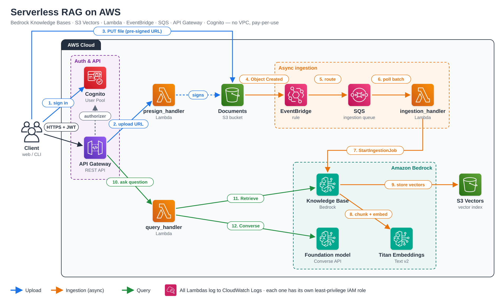

# rag-serverless-aws

A serverless **Retrieval-Augmented Generation (RAG)** assistant on AWS, built with Amazon Bedrock Knowledge Bases, Amazon S3 Vectors, AWS Lambda, Amazon EventBridge, Amazon SQS, Amazon API Gateway and Amazon Cognito.

## Objective

Build a production-style RAG assistant that answers questions about your own documents, **with citations to the sources**, using only pay-per-use serverless services, so that the idle cost stays close to **$0**.

The project is also a deep, hands-on lab. Every component is first built manually in the AWS Console to understand it, and then codified in Terraform. The project follows these principles:

- **Least privilege**: each component has its own IAM role, with only the actions it needs, scoped to specific resource ARNs.
- **Serverless and pay-per-use**: no always-on infrastructure. S3 Vectors replaces OpenSearch Serverless as the vector store.
- **Infrastructure as Code**: the whole stack is deployable with a single `terraform apply`.
- **Documented decisions**: every important trade-off is recorded as an ADR in [`docs/adr/`](docs/adr/).

## Architecture



The diagram is drawn as code with the official AWS icons: see [`docs/diagrams/architecture.py`](docs/diagrams/architecture.py). Regenerate it with `python docs/diagrams/architecture.py --png`.

### Flows

**Upload (pre-signed URL)**
1. The client signs in with Amazon Cognito and gets a JWT.
2. The client calls `POST /documents/upload-url`. API Gateway validates the JWT with a Cognito authorizer.
3. `presign_handler` returns a short-lived pre-signed URL, scoped to one object key.
4. The client uploads the document **directly to S3**. The file never goes through Lambda or API Gateway.

**Ingestion (asynchronous)**
1. S3 sends an *Object Created* or *Object Deleted* event to Amazon EventBridge. An EventBridge rule filters the event (bucket and prefix) and sends it to an SQS queue.
2. `ingestion_handler` consumes the events in batches and calls `StartIngestionJob`. SQS solves a real constraint: a Knowledge Base runs **only one ingestion job at a time** per data source, so many uploads must collapse into one sync.
3. The Knowledge Base reads the documents, splits them into chunks, computes embeddings with Amazon Titan Text Embeddings v2 and stores the vectors in S3 Vectors.

**Query**
1. The client calls `POST /query` with a question.
2. `query_handler` calls `Retrieve` to get the most relevant chunks, builds its own prompt and calls the `Converse` API.
3. The response includes the answer and the source citations.

## Components and least-privilege roles

| Component | Responsibility | Allowed actions (scoped) |
|---|---|---|
| `presign_handler` | Generate pre-signed upload URLs | `s3:PutObject` on `documents-bucket/uploads/*` |
| `ingestion_handler` | Trigger Knowledge Base syncs | `sqs:ReceiveMessage`, `sqs:DeleteMessage`, `sqs:GetQueueAttributes` on the queue; `bedrock:StartIngestionJob` on the Knowledge Base |
| `query_handler` | Retrieve + generate | `bedrock:Retrieve` on the Knowledge Base; `bedrock:InvokeModel` on the chosen model |
| EventBridge rule → SQS | Deliver upload and delete events | Target IAM role: `sqs:SendMessage` on the ingestion queue only; trust limited to `events.amazonaws.com` with `aws:SourceAccount` and `aws:SourceArn` = the rule ARN |
| Knowledge Base service role | Ingestion pipeline | `s3:GetObject`, `s3:ListBucket` on the documents bucket; `bedrock:InvokeModel` on Titan Embeddings; `s3vectors:*Vectors` on the vector index |

All functions also get permissions to write their own CloudWatch Logs only.

## Repository structure

```text
rag-serverless-aws/
├── infra/                # Terraform
│   ├── modules/
│   │   ├── ingestion/    # S3, EventBridge, SQS, ingestion Lambda, Knowledge Base, S3 Vectors
│   │   └── api/          # Cognito, API Gateway, presign and query Lambdas
│   ├── main.tf
│   └── variables.tf
├── src/
│   ├── presign_handler/
│   ├── ingestion_handler/
│   └── query_handler/
├── docs/                 # architecture diagram (as code), costs, ADRs
├── sample-docs/          # test documents
└── README.md
```

## Roadmap

- [ ] Phase 1 — Build each component manually in the AWS Console
- [ ] Phase 2 — Codify the stack in Terraform
- [ ] Phase 3 — Hardening: observability, dead-letter queue, throttling, WAF
- [ ] Phase 4 — Cost analysis: S3 Vectors vs OpenSearch Serverless

## What I learned

_To be written by the author._
