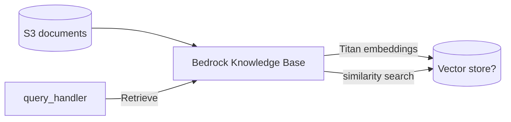

# 0001. Use Amazon S3 Vectors as the vector store

- **Status:** Accepted
- **Date:** 2026-11-25

## Context

The Bedrock Knowledge Base needs a vector store for the chunk embeddings. The project has three constraints:

- **Cost ≈ $0 when idle.** It runs in a personal account, and anyone who clones the repo should be able to deploy it without a surprise bill.
- **Fully serverless and pay-per-use.** There should be no capacity to provision or manage.
- **Native integration with Bedrock Knowledge Bases**, so ingestion (chunking, embeddings and storage) stays a managed service.

The workload is small: tens to thousands of documents, with low query volume.

## Options considered

| Option | Pros | Cons |
|---|---|---|
| **Amazon S3 Vectors** | Pay only for storage, uploads and queries, so idle cost is ≈ $0. AWS claims up to 90% lower total cost. Native Knowledge Bases integration. No capacity to manage. Generally available since December 2025. | Higher query latency than in-memory engines (sub-second rather than milliseconds). Fewer search features (no rich hybrid scoring or aggregations). Settings like dimension and metric can't change after the index is created. |
| **Amazon OpenSearch Serverless** | Classic Knowledge Bases option. Low latency, hybrid search and rich filtering. | Billed per OCU-hour with a minimum footprint, about $175/month even in dev mode with redundancy off. That breaks the ≈ $0 goal and scares away anyone replicating the repo. |
| **Aurora Serverless v2 (pgvector)** | SQL plus vectors in one engine. Can scale to 0 ACUs. Supported by Knowledge Bases. | Cold resume after scaling to zero. Needs a VPC, a cluster and Secrets Manager, which add operational and networking overhead (this project has no VPC). |
| **Pinecone (serverless)** | Free tier. Supported by Knowledge Bases. | Third-party SaaS outside AWS: an external API key to manage, data leaves the account, and it says less about AWS architecture skills. |

## Decision

Use **Amazon S3 Vectors**. It is what makes the project truly serverless and cheap. OpenSearch Serverless has a minimum monthly cost that is not acceptable for a personal lab, or for anyone who wants to replicate the repository. S3 Vectors integrates natively with Bedrock Knowledge Bases, and AWS reports up to 90% lower cost to upload, store and query vectors. The cost comparison is also valuable content for the project.

## Consequences

- ✅ Idle cost is ≈ $0, and the stack can be deployed and destroyed freely.
- ✅ No VPC, cluster or capacity planning.
- ⚠️ Query latency is higher than OpenSearch. That's acceptable for a Q&A assistant, where LLM generation dominates the response time.
- ⚠️ Index settings are immutable (see [ADR 0002](0002-vector-index-configuration.md)). Changing them means re-creating the index and re-ingesting.
- 🔁 Revisit if the project needs hybrid search at scale, sub-100 ms retrieval or high QPS. OpenSearch Serverless would then be the upgrade path.
