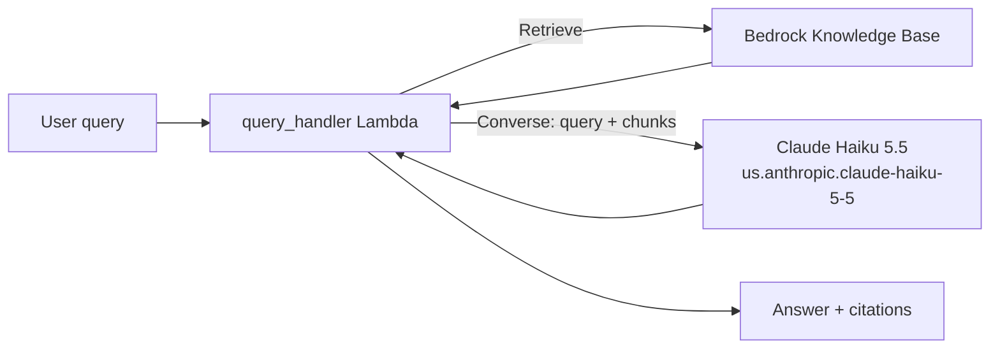

# 0004. Use Claude Haiku 5.5 as the generation model

- **Status:** Superseded by [0005](0005-use-claude-haiku-4-5-for-generation.md)
- **Date:** 2026-11-25

## Context

The `query_handler` Lambda retrieves chunks from the Knowledge Base (`Retrieve`) and sends them to an LLM through the Bedrock Converse API to generate the answer. That model has to be picked now: the on-demand Bedrock quota of a new account starts at 0, and the quota increase is requested per model.

The goal of this lab is to build and test the serverless RAG pipeline (ingestion, retrieval, API, auth), not to push answer quality to the limit. The model is called once per user query with a small context (a few retrieved chunks), so speed and cost per call matter more than deep reasoning.

## Options considered

Prices are Anthropic list prices per 1M tokens (input / output). Bedrock prices can differ slightly, but the ratios hold.

| Option | Pros | Cons |
|---|---|---|
| **Claude Haiku 5.5** ($0.10 / $0.50) | Current generation. The fastest and cheapest Claude model, about 10× cheaper than Haiku 4.5. Strong enough to answer from retrieved context. Available in us-east-1 through the `us.` cross-region inference profile. | Less depth than Sonnet or Opus on complex reasoning. |
| Claude Haiku 4.5 ($1 / $5) | Known model, already used in production at work. | Previous generation, about 10× more expensive than Haiku 5.5 for the same role. |
| Claude Sonnet 5.5 ($2 / $10) | Better reasoning and writing quality. | About 20× the cost of Haiku 5.5 and slower. That quality isn't needed to validate the pipeline. |
| Amazon Nova (Micro / Lite) | First-party AWS model, low cost. | No previous experience with it. Keeping Claude makes the lab more relevant to the work I already do. |

## Decision

Use **Claude Haiku 5.5** (`us.anthropic.claude-haiku-5-5`, cross-region inference profile).

Haiku is a fast model. Maybe it doesn't have the depth of models like Sonnet or Opus, which are excellent for other tasks. Here I only want to test the RAG system, the pipeline, and a bigger model would mean spending money I don't need to spend. I already used Haiku at work to build a recommendation system, and it worked very well because it is fast and cheap, which is very important in production. So this decision is not only technical but also economic. Between the two Haiku models, Haiku 5.5 is the newer one and about 10× cheaper, so it fits that reasoning even better.

## Consequences

- ✅ Low latency per query and near-zero cost at lab scale.
- ✅ The pipeline doesn't depend on the model: the model ID is a Lambda setting, so switching to Sonnet later doesn't change the architecture.
- ⚠️ Answers to complex, multi-step questions may be weaker. Re-evaluate if retrieval is good but the answers aren't.
- ⚠️ Cross-region inference profile: the `query_handler` IAM policy must allow `bedrock:InvokeModel` on the inference profile ARN **and** on the underlying foundation model in every US region the profile routes to.
- ⚠️ Always set `maxTokens` explicitly in Converse calls. The quota approved for Haiku 5.5 (10M tokens/min, the minimum the form allows) is far above lab needs, so cost control relies on `maxTokens`, API Gateway throttling, Lambda reserved concurrency and the $5 AWS Budget.
- 🔁 Changing the model is a new ADR that supersedes this one.
