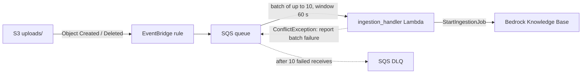

# 0006. Ingestion trigger: SQS batching, Lambda and retry on conflict

- **Status:** Accepted
- **Date:** 2026-11-26

## Context

When a document is uploaded to or deleted from `uploads/`, the Knowledge Base must be synced with `StartIngestionJob`. Three facts shape the design:

- `StartIngestionJob` doesn't take a list of files. It re-scans the whole data source, so one call covers any number of changes.
- Bedrock runs **only one ingestion job at a time** per data source. A second call while a job is running fails with `ConflictException`.
- S3 sends one event per object, so 10 uploads produce 10 events.

S3 events already flow S3 → EventBridge (default bus) → SQS `rag-serverless-ingestion-queue`. This ADR decides what consumes the queue and what happens on a conflict.

## Options considered

**Who triggers the sync**

| Option | Pros | Cons |
|---|---|---|
| **SQS → Lambda** | Native batching (batch size + window). Room for small logic: skip folder placeholders, handle `ConflictException`, clear logs. Easy to test. | One more piece of code to maintain. |
| EventBridge rule → Bedrock directly | Fewest components. | Not possible: Bedrock isn't a rule target. Without a queue, every upload is a separate sync attempt and conflicts are lost. |
| SQS → EventBridge Pipes → Step Functions (AWS SDK integration) | No code. Declarative `Retry` on `ConflictException`. | More services to learn and debug for a very small task. |
| EventBridge Scheduler every N minutes | No code, no queue. | Not event-driven: up to N minutes of delay, and syncs run even when nothing changed. |

**What to do on `ConflictException`**

| Option | Pros | Cons |
|---|---|---|
| **Report the batch as failed and let SQS retry** | The Lambda finishes in milliseconds. The visibility timeout (180 s) works as a free "try again later" timer. | `maxReceiveCount` must be high enough (10) so a long job doesn't push valid messages to the DLQ. |
| Wait inside the Lambda until the job finishes | Simple to reason about. | Pays for idle Lambda time. A long job can exceed the Lambda timeout. |
| Ignore the conflict and delete the messages | Simplest. | Changes uploaded while a job runs may never be indexed (stale data). |

## Decision

Keep the **SQS → Lambda** trigger and **report the batch as failed on `ConflictException`**, so SQS redelivers it later.

The Lambda doesn't process the documents. It only tells Bedrock that something changed, and Bedrock does the real work. The queue keeps the system decoupled and lets many uploads become one sync. Bedrock can only run one ingestion job at a time, so when there is a conflict the Lambda doesn't wait: it returns the messages to the queue and SQS retries them after the visibility timeout. Pipes + Step Functions would also work without code, but for this lab I want the Lambda to control this logic.

Settings:

- Event source mapping: batch size **10**, batching window **60 s**, maximum concurrency **2** (the minimum AWS allows), **report batch item failures** on.
- Queue: visibility timeout **180 s** (6× the Lambda timeout of 30 s), `maxReceiveCount` **10** (about 30 minutes of retries) before the DLQ.

## Consequences

- ✅ Many uploads in a short time produce one sync.
- ✅ No idle Lambda time. Conflicts are retried automatically.
- ✅ The DLQ only receives messages that keep failing for about 30 minutes, which signals a real problem (permissions, bugs).
- ⚠️ A change can take a few minutes to be searchable (batching window + possible retry). That's acceptable for documents.
- ⚠️ Retried messages trigger a sync even if a previous job already indexed their files. The extra job finds nothing new, so the cost is negligible.
- 🔁 If the trigger logic grows (e.g. per-file workflows), reconsider Step Functions.
