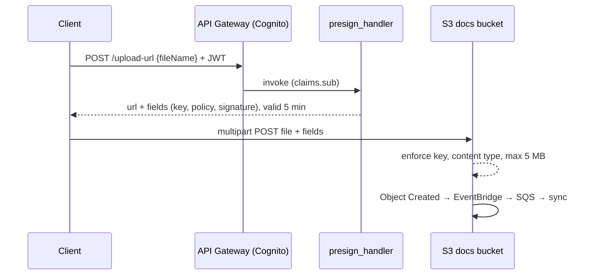

# 0008. Upload documents with pre-signed POST into a per-user prefix

- **Status:** Accepted
- **Date:** 2026-11-26

## Context

Authenticated users must be able to add documents to the Knowledge Base without access to the AWS console. Files can be several MB, and API Gateway REST has a 10 MB payload limit and a 29 s timeout, so files shouldn't pass through API Gateway or Lambda. Once a file lands in `uploads/`, the existing pipeline (EventBridge → SQS → `ingestion_handler`, ADR 0006) syncs it automatically.

Every upload costs ingestion (Titan embeddings) and storage, so uploads must be limited in size and type.

## Options considered

**Upload mechanism**

| Option | Pros | Cons |
|---|---|---|
| **Pre-signed POST** | S3 enforces a policy: exact key, content type and `content-length-range` (max size). | Multipart form upload, slightly more work for the client. |
| Pre-signed PUT | Simplest client (`curl -T`). | S3 can't enforce a size limit, so a user could upload huge files and raise ingestion costs. |
| Upload through API Gateway + Lambda | One request. | 10 MB / 29 s limits, and the Lambda pays for transfer time. |

**Object key**

| Option | Pros | Cons |
|---|---|---|
| **`uploads/<cognito-sub>/<uuid>-<fileName>`** | Each user has their own folder. The UUID avoids overwriting files with the same name. Traceability: every file shows who uploaded it. | Longer keys. |
| `uploads/<fileName>` | Simple. | Two users uploading `policy.pdf` overwrite each other. |

## Decision

Use **pre-signed POST** with the key **`uploads/<cognito-sub>/<uuid>-<fileName>`**.

The idea is that each user creates their own folder, so files from different users never collide and we know who uploaded each one. Pre-signed POST because S3 itself enforces the upload policy (size, type and key), so the limit doesn't depend on the client behaving well.

Guardrails:

- Max size **5 MB** (`content-length-range`), URL valid **5 minutes**.
- Allowed extensions: `.pdf .md .txt .docx .html .csv` (formats the Knowledge Base can parse), with a matching `Content-Type`.
- File name sanitized (base name only, safe characters, max 100 characters).
- The user's `sub` comes from the Cognito authorizer claims, never from the request body.
- The Lambda role can only `s3:PutObject` on `uploads/*`.

## Consequences

- ✅ Files never pass through Lambda or API Gateway, so no payload or timeout limits and no transfer cost in Lambda.
- ✅ S3 rejects oversized files or wrong keys, even if a client is malicious.
- ✅ The Knowledge Base data source (`uploads/`) and the EventBridge rule (prefix `uploads/`) already cover subfolders, so nothing else changes.
- ⚠️ All users share one Knowledge Base, so any user can query documents uploaded by others. Per-user isolation would need metadata filtering on retrieval. That's out of scope for this lab.
- ⚠️ A browser client will need a CORS rule on the bucket. The CLI doesn't.
- 🔁 Deleting documents through the API isn't covered yet.
